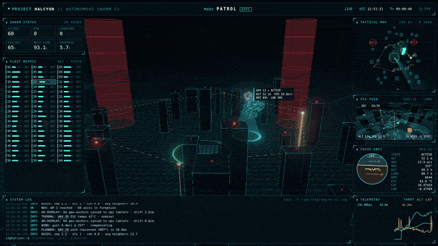

<div align="center">

[Español](README.md) | **English**

# 🛰️ Drone Swarm Mission Control (SWARM C2)

An interactive 3D dashboard that simulates the **command center of an autonomous drone swarm**.<br>
Everything lives in a single HTML file: open it and it keeps running on its own.

[](https://bluongov.github.io/drone-swarm-c2/)

  



<sub>Higher-quality video: [`assets/demo.mp4`](assets/demo.mp4)</sub>

</div>

---

## 📌 Why this project exists

It started as an **ambient display for the desk**: something visual, technical and always moving for a secondary monitor. It also works as a demo and as a hands-on exercise in:

- **3D graphics in the browser** with Three.js (post-processing, multi-view rendering, instanced geometry).
- **Swarm algorithms** (Reynolds boids) with mission modes, obstacle avoidance and geofencing.
- **Mission-control HUD design**: telemetry, tactical map, artificial horizon and a system log.

Design goals:
- **Alive**: it never stands still. Drones take off, patrol, switch missions and fly back to recharge.
- **Believable**: the telemetry, logs and terminology (boids, EKF2, SLAM, geofence, MAVLink, RTK) come from the real UAV/robotics world, even though the data is simulated.
- **Interactive**: you can click, switch modes and type commands in a built-in terminal.
- **Zero friction**: a single file, nothing to install and no server.

> ⚠️ **Everything is simulated.** It does not connect to any real drones, networks or systems. Log messages and telemetry values are generated procedurally.

---

## 🚀 Getting started

**Online:** 👉 **https://bluongov.github.io/drone-swarm-c2/**

**Locally:**
```bash
git clone git@github.com:bluongov/drone-swarm-c2.git
cd drone-swarm-c2

# Option 1: double-click index.html
# Option 2: from a terminal (Linux)
xdg-open index.html
# Option 3: local server (recommended; lets changes persist in the URL)
python3 -m http.server 8080   # → http://localhost:8080
```

Then press **`F`** for fullscreen and leave it running.

**Requirements:** a modern browser with WebGL (Chrome, Edge or Firefox) and an **internet connection**, because Three.js is loaded from the jsDelivr CDN.

---

## 🎮 Keyboard & mouse controls

| Key / action | What it does |
|---|---|
| **Click on the ground** | In `PATROL` it inserts a priority waypoint. In the other modes the swarm switches to **orbiting** that point. |
| **Drag / wheel** | Rotate and zoom the camera (OrbitControls) |
| `1` `2` `3` `4` | `PATROL` · `ORBIT` · `FORMATION` · `SCAN` mode |
| `C` | Toggle between the orbital overview and the **chase camera** on the selected drone |
| `A` | Turn automatic mode rotation (every 50 s) on or off |
| `H` | Hide or show the HUD (leaves only the 3D scene) |
| `F` | Fullscreen |
| `Enter` or `/` | Open the built-in terminal to type commands |
| `Esc` | Leave the terminal |
| Click a *Fleet Matrix* cell | Select that drone (FPV camera, horizon and telemetry) |

---

## 💻 Built-in terminal commands

The **SYSTEM LOG** panel doubles as a terminal (`c2@halcyon:~$`). Press `Enter`, type, and press `Enter` again. The `↑`/`↓` arrows browse the history.

| Command | Example | Description |
|---|---|---|
| `help` | `help` | List the commands |
| `drones=N` | `drones=40` · `drones 5` | Change the swarm size **live** (1–150). New drones take off in a staggered sequence and extra ones are removed. |
| `mode=...` | `mode=orbit` · `mode scan` | `patrol`, `orbit`, `formation` or `scan` |
| `quality=low\|high` | `quality=low` | `low` uses 1x resolution and turns off bloom (**more FPS**) |
| `name=TEXT` | `name=Skynet` | Change the project name in the header (24 characters max) |
| `auto=on\|off` | `auto=off` | Automatic mode rotation |
| `status` | `status` | Summary: active, RTB and charging drones, mode, quality and FPS |
| `clear` | `clear` | Clear the log |

Both `drones=40` and `drones 40` work. When the browser allows it, changes to `drones`, `name` and `quality` are saved in the URL, so they survive a refresh. Some browsers block this over `file://`; in that case use a local server.

---

## 🔗 URL parameters

Use these to start with a preset configuration:

```
index.html?name=SKYNET&drones=40&quality=low&lat=40.4168&lon=-3.7038
```

| Parameter | Default | Description |
|---|---|---|
| `name` | `HALCYON` | Project name |
| `drones` | `60` | Number of drones (1–150) |
| `quality` | `high` | `low` for less powerful machines |
| `lat`, `lon` | Valencia (39.4699, -0.3763) | Origin of the displayed GPS coordinates |
| `embed` | — | `1` disables wheel zoom (for embedding in an `<iframe>` without hijacking page scroll) |

---

## ⚡ Performance

If it runs slowly:
1. `quality=low` in the terminal (bloom is the most expensive part).
2. `drones=30` or fewer.
3. `H` hides the HUD, which also stops rendering the FPV camera (one fewer render per frame).

The FPS counter is at the top right and is also shown by `status`.

---

## 🧩 What's on screen

```
┌──────────────────────────── PROJECT X // AUTONOMOUS SWARM C2 ── MODE ── UTC ── T+ ── FPS ─┐
│ SWARM STATUS  │                                              │ TACTICAL MAP (radar,       │
│ (active, RTB, │                                              │ coverage, NFZ, routes)     │
│ charging, bat,│            3D SCENE (Three.js)               ├────────────────────────────┤
│ link, cover.) │   wireframe city · swarm · NFZ · base        │ FPV FEED (drone camera)    │
├───────────────┤                                              ├────────────────────────────┤
│ FLEET MATRIX  │                                              │ FOCUS UNIT (artificial     │
│ (bat/state    │                                              │ horizon + telemetry)       │
│ per drone)    │                                              │                            │
├───────────────┴──────────────────────────────────────────────┼────────────────────────────┤
│ SYSTEM LOG + interactive terminal                            │ TELEMETRY (THRPT/ALT/LAT)  │
└──────────────────────────────────────────────────────────────┴────────────────────────────┘
```

- **3D scene**: wireframe terrain with hills on the outskirts, 28 randomly generated buildings with red beacons, 2 no-fly zones (red cylinders), a charging base with landing pads, and drones with status LEDs, strobes and trails.
- **Selected drone**: ring, scan cone down to the ground and a floating label. It changes every 10 s.
- **“RETASKING SWARM” banner** whenever the mission changes.

---

## 🛠️ How it was built (technical reference)

### Stack
- **A single file**: `index.html` (HTML, CSS and JS in one ES module).
- **Three.js r160** through an `importmap` from jsDelivr, with no bundler and no `npm install`.
- Three.js addons: `OrbitControls`, `EffectComposer` + `UnrealBloomPass` + `OutputPass` (bloom) and `BufferGeometryUtils.mergeGeometries` (drone geometry).
- HUD in **HTML/CSS** with `backdrop-filter` panels, decorative corners and scanlines, plus **Canvas 2D** for the map, horizon and charts.

### 1. Swarm algorithm (Reynolds boids)
Each drone computes its acceleration as a weighted sum of *steering* forces (`desired − velocity`, capped at `MAXF`):

| Force | What it does |
|---|---|
| **Separation** | Moves away from neighbours closer than `R_SEP = 7`, weighted by `1/d²` |
| **Alignment** | Matches the average velocity of neighbours within `R_NEI = 16` |
| **Cohesion** | Steers toward the neighbours' center of mass |
| **Goal** | Seeks its goal with *arrival* (slows down when close) |
| **Avoidance** | Radial push away from buildings and NFZs, plus a vertical push over rooftops |
| **Bounds** | Altitude between 14 and 100 m and a ±200 m area |

The weights depend on the mode (`MODE_W`):

| Mode | Behaviour | How the goal is computed |
|---|---|---|
| `PATROL` | Classic flocking (high alignment and cohesion) | Current waypoint plus a per-drone offset. When the centroid gets within 30 m it moves to the next one, and a new route is generated at the end. |
| `ORBIT` | Concentric rings (3 radii and altitudes, one counter-rotating) | `center + (cos a·R, alt, sin a·R)` with the phase spread by *slot* |
| `FORMATION` | V (chevron) formation behind a virtual leader | The leader follows a Lissajous curve and slots are computed from its *forward* and *right* vectors |
| `SCAN` | A curtain sweeping across the city | Lanes along X (alternating altitudes to avoid collisions) and an oscillating Z |

*Slots* are reassigned every 2 s, or when the number of active drones changes, sorting by position (X in SCAN, angle in ORBIT, distance to the leader in FORMATION) so drones don't cross paths.

It is O(n²) per frame, which is enough for up to 150 drones.

### 2. Per-drone state machine
```
IDLE ──(staggered delay)──► LAUNCH ──(alt>24m)──► ACTIVE ──(bat<15%)──► RTB
  ▲                                                                      │
  └──────────── CHARGING ◄──(touchdown)── LANDING ◄──(over its pad)──────┘
                    │ (bat=100%)
                    └──────────► LAUNCH
```
- Battery drains at 0.32–0.6 %/s (varies per drone) and charges at 8 %/s. This keeps drones constantly flying to and from the base, which adds movement and log events.
- LED colour: cyan (ACTIVE), yellow (RTB/LANDING), blinking green (CHARGING) and white (LAUNCH).
- Orientation comes from velocity (yaw) and acceleration (forward pitch and roll in turns), the same way a real quadcopter tilts.

### 3. Rendering
- **Bloom** (`UnrealBloomPass`) for the neon look. Turned off with `quality=low`.
- **FPV camera**: the same scene is rendered a second time from another camera, using `setViewport` and `setScissor` on the FPV panel's rectangle. That panel has no background or blur so the render underneath shows through. The drone and its markers are hidden during that render.
- **Trails**: `THREE.Line` with a 40-point ring buffer, gradient vertex colours and `AdditiveBlending`.
- Charging pads use an `InstancedMesh`, rebuilt when the drone count changes.

### 4. HUD & data
- **Tactical map**: buildings, NFZs, radar sweep, route and waypoints, drones coloured by state, and a **coverage map**. The grid is 24×24 cells; a cell counts as covered if an active drone passed over it in the last 90 s. That value is the COVERAGE %, and it is actually computed.
- **Selected-drone telemetry**:
  - Real simulation values: ALT, SPD, HDG, BAT and LINK (depends on distance to the base).
  - Derived values: RPM and ESC temperature.
  - LAT/LON: position converted to degrees from `lat`/`lon` (1 unit = 1 m).
- **Log**: boot messages, real simulation events (RTB, landings, waypoints, geofence, mode changes) and procedural “chatter” every 0.35–1.3 s (SLAM, EKF2, mesh, vision, consensus, AR overlay…).
- The text HUD updates every 250 ms. The map and horizon are drawn every frame.
- The layout adapts to screen height: the map and FPV panel scale with `vh`.

### 5. Interactive terminal
It is an `<input>` inside the log panel. `runCmd()` parses `command[=| ]argument`. `setDroneCount()` does the following:
- Frees the extra drones (`dispose()` on materials and geometries).
- Rebuilds the pads and reassigns each drone's pad.
- Creates the new drones with a staggered takeoff.
- Regenerates the *Fleet Matrix* panel.

Keyboard shortcuts are ignored while you type in the terminal.

### 6. How it was verified
- `node --check` on the extracted script (syntax).
- **Playwright + headless Chromium** (WebGL through SwiftShader): the page was loaded, and the modes, ground clicks, chase camera and every terminal command (`help`, `drones=10/25/5`, `mode orbit`, `quality=low`, `name=...`, an unknown command and `status`) were tested, checking screenshots and that the console showed no errors.

### 7. How the GIF was made
Software rendering in a headless browser only reaches ~4 FPS, so the recording uses **Playwright's `page.clock`** (virtual time). The script advances the clock by 1/12 s, takes a screenshot and repeats, so the animation is smooth regardless of actual performance. Script: [`tools/record-gif.mjs`](tools/record-gif.mjs).

```bash
npm i --no-save playwright gifsicle && npx playwright install chromium
node tools/record-gif.mjs                                   # → frames/*.png (1600x900, 12 fps)

# GIF (optimized palette + lossy compression → ~6 MB)
ffmpeg -framerate 12 -i frames/f%04d.png -vf "fps=8,scale=720:-1:flags=lanczos,palettegen=max_colors=64:stats_mode=diff" pal.png
ffmpeg -framerate 12 -i frames/f%04d.png -i pal.png -lavfi "fps=8,scale=720:-1:flags=lanczos[x];[x][1:v]paletteuse=dither=none:diff_mode=rectangle" tmp.gif
npx gifsicle -O3 --lossy=100 tmp.gif -o assets/demo.gif

# Higher-quality MP4
ffmpeg -framerate 12 -i frames/f%04d.png -vf scale=1280:-2 -c:v libx264 -pix_fmt yuv420p -crf 28 -movflags +faststart assets/demo.mp4
```

The scanlines (`#fx`) are hidden during recording, because the line pattern makes the GIF several times larger.

---

## 🔧 Where to customize

Everything is in `index.html`, inside the `<script type="module">`:

| What | Where |
|---|---|
| Speed, force and neighbour radii | `const MAXS, MAXF, R_NEI, R_SEP` |
| Flocking weights per mode | `const MODE_W` |
| Colours per state | `STATE_COLOR` and the `:root` CSS variables (`--c`, `--g`, `--y`, `--r`) |
| How often the mode changes | `modeTimer > 50` in the main loop |
| How often the selected drone changes | `focusTimer > 10` |
| Battery drain and charge | `this.drain = rand(...)` · `dt * 8` · `battery < 15` |
| Number of buildings and NFZs | `CITY / OBSTACLES` block |
| Log messages | `gen` array in `chatter()` and the `boot` array |
| New terminal commands | `switch (cmd)` in `runCmd()` |

---

## 💡 Ideas for later
- **Augmented reality** mode with the webcam and MediaPipe (hand/face tracking) in a panel.
- Live air traffic (ADS-B) on the map.
- Bundle Three.js locally (`vendor/`) so it works offline.
- A spatial grid for boid neighbour lookups to support 500+ drones.
- Configurable colour theme (`theme=amber`, `theme=green`).

---

## 📁 Structure

```
drone-swarm-c2/
├── index.html            # the whole app (HTML + CSS + JS)
├── README.md             # documentation (Spanish)
├── README.en.md          # documentation (English)
├── assets/
│   ├── demo.gif          # README GIF
│   ├── demo.mp4          # higher-quality video
│   └── screenshot.png
└── tools/
    └── record-gif.mjs    # demo recording with Playwright (virtual clock)
```
