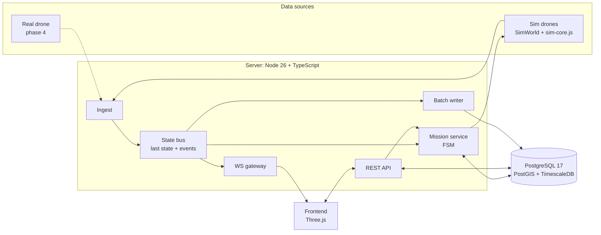
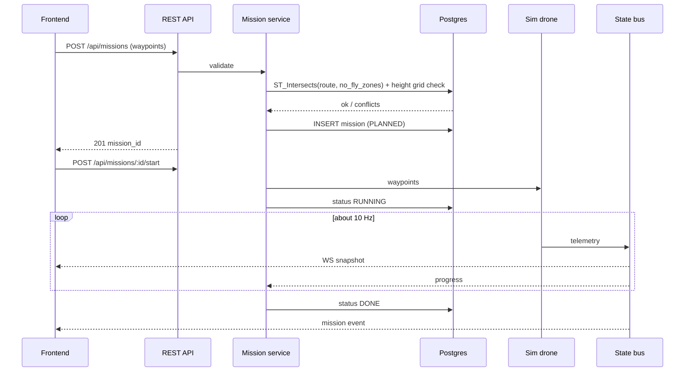

# Drone Swarm C2: target architecture

Reference for the move from "everything simulated in the browser" to "server owns drone and mission state".
Drawing: [`architecture.svg`](architecture.svg) / [`architecture.png`](architecture.png).

Status: v1 implemented on branch `feat/server-backend` (phases 1-3). See README "Server mode" for how to run it.

## Decisions

| # | Decision | Why |
|---|---|---|
| 1 | One database: PostgreSQL 17 + PostGIS + TimescaleDB | Maps, NFZ polygons, missions and telemetry in one place. About 1,500 rows/s (150 drones x 10 Hz) is easy for it. |
| 2 | QuestDB only as an optional later telemetry sink | It supports box, radius and geohash queries, but no polygons, no foreign keys and limited UPDATE/DELETE. Worth it only at 100k+ msgs/s. |
| 3 | Server: Node 26 + TypeScript (Fastify + `ws`) | Same language as the frontend; Rust can replace the sim core later behind a clean `step(dt)` interface. |
| 4 | The sim is a "fake drone" that uses the same ingest as a real drone | Real telemetry can replace it with no frontend change. |
| 5 | Server drones run the real flocking code, extracted into a shared `sim-core.js` used by both browser and server | Keeps behaviour identical to the demo. A golden baseline from the original code and a seeded browser-vs-Node parity test guard it. Details: `implementation-plan.md`. |
| 6 | Frontend keeps the offline mode | No `?server=` param means today's behaviour, so GitHub Pages and the bluongo.com embed keep working. |

## Component diagram

## Mission flow

## Data model (v1 tables)

| Table | Key columns |
|---|---|
| `sites` | id, name, origin lat/lon, theta, cell size, grid size |
| `site_layers` | site_id, kind (`height`, `cover`, `cac_formulas`, `buildings`), data (bytea or JSONB) |
| `no_fly_zones` | id, site_id, name, geom (PostGIS polygon) |
| `drones` | id, name, swarm, kind (`sim` or `real`) |
| `missions` | id, site_id, status, created_at, started_at, ended_at |
| `mission_waypoints` | mission_id, seq, lat, lon, alt |
| `telemetry` (hypertable) | ts, drone_id, lat, lon, alt, vel, heading, battery, state |

Coordinates are stored as WGS84. The frontend keeps converting with `siteToScene` / `geoToSite`.

## API sketch

| Endpoint | Purpose |
|---|---|
| `GET /api/sites/:id` | Map payload (same shape as `window.CITY` / `window.CAC`) |
| `POST /api/missions` | Create a mission, run route checks |
| `POST /api/missions/:id/start` / `abort` | Mission control |
| `POST /ingest` or `WS /ingest` | Telemetry in (real or sim drone) |
| `WS /live` | About 10 Hz snapshots of all drones + mission events |

## Phases

| Phase | Result |
|---|---|
| 1 | docker-compose DB, schema, map export + loader |
| 2 | `sim-core.js` extracted, server runs it, ingest, WebSocket, frontend `?server=` mode |
| 3 | Server-run mission (new `MISSION` mode, route validation in PostGIS) |
| Later | MQTT broker, MAVLink bridge, BRAVO / hostile wiring in server mode, auth, deploy |

Step-by-step execution plan, contracts and test gates: [`implementation-plan.md`](implementation-plan.md).

## Sources

- QuestDB spatial functions: https://questdb.com/docs/query/functions/spatial/
- QuestDB GIS tracking issue: https://github.com/questdb/questdb/issues/4899
- Timescale is now Tiger Data: https://www.tigerdata.com/blog/timescale-becomes-tigerdata
- QuestDB vs TimescaleDB (vendor benchmark, read with that bias): https://questdb.com/blog/timescaledb-vs-questdb-comparison/
- Pattern only (AI-generated example doc): https://github.com/gauravs19/archpilot/blob/main/examples/droneops-fleet-management/Design_HLD.md
